

<picture><source media="(max-width: 480px)" srcset="./assets/generated/hero-mobile.svg">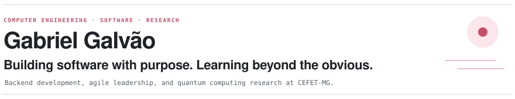</picture>
<picture><source media="(max-width: 480px)" srcset="./assets/generated/status-mobile.svg">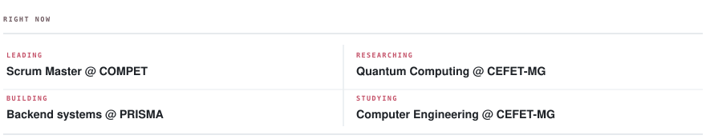</picture>

 

<picture><source media="(max-width: 480px)" srcset="./assets/generated/current-header-mobile.svg"></picture>

<picture><source media="(max-width: 480px)" srcset="./assets/generated/focus-0-mobile.svg">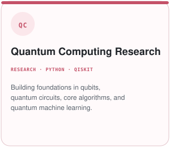</picture>
<picture><source media="(max-width: 480px)" srcset="./assets/generated/focus-1-mobile.svg">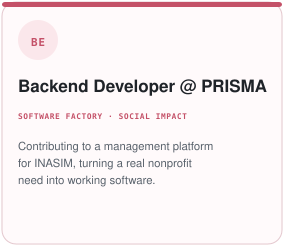</picture>
<picture><source media="(max-width: 480px)" srcset="./assets/generated/focus-2-mobile.svg">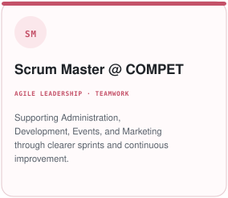</picture>

<picture><source media="(max-width: 480px)" srcset="./assets/generated/experience-header-mobile.svg"></picture>
<picture><source media="(max-width: 480px)" srcset="./assets/generated/experience-mobile.svg">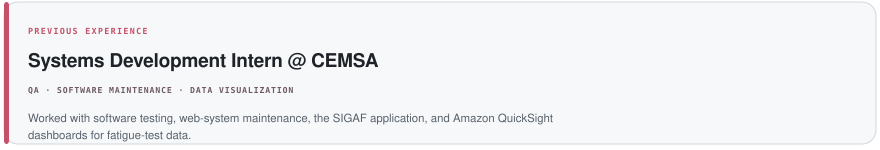</picture>

<picture><source media="(max-width: 480px)" srcset="./assets/generated/projects-header-mobile.svg"></picture>

<a href="https://github.com/gabrielgdrbandeira/Dmabe"><picture><source media="(max-width: 480px)" srcset="./assets/generated/project-0-mobile.svg">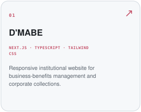</picture></a>
<a href="https://github.com/gabrielgdrbandeira/FidelisCota"><picture><source media="(max-width: 480px)" srcset="./assets/generated/project-1-mobile.svg">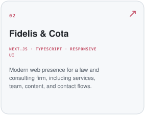</picture></a>
<a href="https://github.com/gabrielgdrbandeira/3D-Working-Services"><picture><source media="(max-width: 480px)" srcset="./assets/generated/project-2-mobile.svg">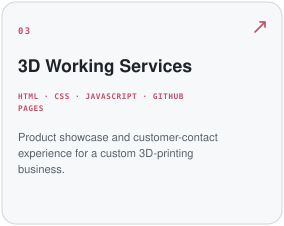</picture></a>

<picture><source media="(max-width: 480px)" srcset="./assets/generated/stack-header-mobile.svg"></picture>
<picture><source media="(max-width: 480px)" srcset="./assets/generated/stack-mobile.svg">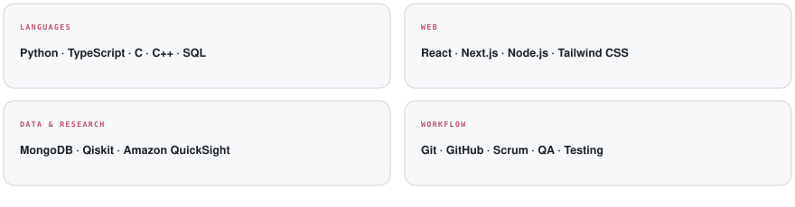</picture>

<picture><source media="(max-width: 480px)" srcset="./assets/generated/contact-header-mobile.svg"></picture>

<a href="https://www.linkedin.com/in/gabriel-galv%C3%A3o-dos-reis-bandeira-7ab960372/"><picture><source media="(max-width: 480px)" srcset="./assets/generated/contact-0-mobile.svg">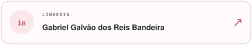</picture></a>
<a href="https://github.com/gabrielgdrbandeira?tab=repositories"><picture><source media="(max-width: 480px)" srcset="./assets/generated/contact-1-mobile.svg">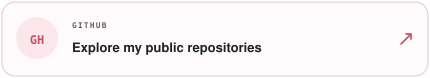</picture></a>

<picture><source media="(max-width: 480px)" srcset="./assets/generated/stats-header-mobile.svg"></picture>
<picture>
  <source media="(prefers-color-scheme: dark)" srcset="https://github-profile-summary-cards.vercel.app/api/cards/profile-details?username=gabrielgdrbandeira&theme=github_dark">
  
</picture>

Accessible text version

# Gabriel Galvão
**Building software with purpose. Learning beyond the obvious.**

Backend development, agile leadership, and quantum computing research at CEFET-MG.

## Current focus
### Quantum Computing Research
*RESEARCH · PYTHON · QISKIT*

Building foundations in qubits, quantum circuits, core algorithms, and quantum machine learning.

### Backend Developer @ PRISMA
*SOFTWARE FACTORY · SOCIAL IMPACT*

Contributing to a management platform for INASIM, turning a real nonprofit need into working software.

### Scrum Master @ COMPET
*AGILE LEADERSHIP · TEAMWORK*

Supporting Administration, Development, Events, and Marketing through clearer sprints and continuous improvement.

## Previous experience
### Systems Development Intern @ CEMSA
*QA · SOFTWARE MAINTENANCE · DATA VISUALIZATION*

Worked with software testing, web-system maintenance, the SIGAF application, and Amazon QuickSight dashboards for fatigue-test data.

## Selected projects
### [D'MABE](https://github.com/gabrielgdrbandeira/Dmabe)
*NEXT.JS · TYPESCRIPT · TAILWIND CSS*

Responsive institutional website for business-benefits management and corporate collections.

### [Fidelis & Cota](https://github.com/gabrielgdrbandeira/FidelisCota)
*NEXT.JS · TYPESCRIPT · RESPONSIVE UI*

Modern web presence for a law and consulting firm, including services, team, content, and contact flows.

### [3D Working Services](https://github.com/gabrielgdrbandeira/3D-Working-Services)
*HTML · CSS · JAVASCRIPT · GITHUB PAGES*

Product showcase and customer-contact experience for a custom 3D-printing business.

## Technical toolkit
- **Languages**: Python, TypeScript, C, C++, SQL
- **Web**: React, Next.js, Node.js, Tailwind CSS
- **Data & Research**: MongoDB, Qiskit, Amazon QuickSight
- **Workflow**: Git, GitHub, Scrum, QA, Testing

## Contact
- [Linkedin](https://www.linkedin.com/in/gabriel-galv%C3%A3o-dos-reis-bandeira-7ab960372/)
- [Github](https://github.com/gabrielgdrbandeira?tab=repositories)

<!-- Generated from profile.json with scripts/build_profile.py. -->
